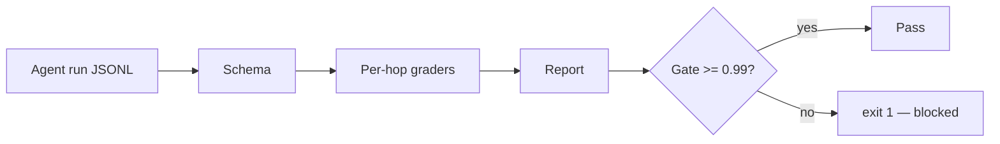

# Trajectory Eval Harness


**Grade every hop of an agent run — not just the final answer — and block bad PRs in CI.**

**Target:** 100+ golden trajectories, CI gate live.
**Shows:** You measure what actually breaks.

## Problem → Solution

Final-answer evals say *that* a run failed, never *where*. This harness grades
each hop (tool choice, argument correctness, state transition) plus the final
answer and final state, ships 120 golden trajectories, and provides a `gate`
command that exits 1 on regression — wired into GitHub Actions so a bad agent
change cannot merge.

## Architecture



See [docs/ARCHITECTURE.md](docs/ARCHITECTURE.md).

## Quickstart (<2 min)

```bash
git clone https://github.com/lionelsimai/trajectory-eval-harness && cd trajectory-eval-harness
pip install -e .
python -m trajectory_eval_harness.cli eval --data data/golden.jsonl
python -m trajectory_eval_harness.cli gate --data data/golden.jsonl --min-score 0.99
python -m pytest -q   # 18 passed
python scripts/generate_golden.py   # regenerate the 120-trajectory golden set
```

## Generator self-check output

The output below is produced from `data/golden.jsonl`, which is
*generator-produced* data (perfect trajectories by construction) — it checks
the grading/gating machinery, not any real agent. For imperfect runs, see
`data/handwritten.jsonl`: 13 hand-written trajectories with known expected
scores, which the test suite asserts the graders reproduce within 0.05
(`eval` on that set: mean 0.7778, pass rate 0.6154).

```json
{ "count": 120, "mean_score": 1.0, "pass_rate": 1.0,
  "worst": [{ "id": "golden-search-book-000", "score": 1.0 }] }
```
```text
GATE PASSED: mean 1.0000 >= 0.99
```
Sample narrative report: [examples/sample-report.md](examples/sample-report.md).

## Benchmarks

```bash
python benchmarks/bench_gate.py
```
Measured in this build (0.1.1): golden set mean 1.0000 (gate passes); a
deliberately regressed copy — every second trajectory, i.e. half of them
(60 of 120), given a wrong first tool + wrong answer — drops the mean to
0.8444 (pass rate 50.00%) and the gate blocks it with exit 1. That catch —
not the perfect score — is the benchmark.

> Correction (0.1.0): the original benchmark corrupted only 10 of 120
> trajectories while the text claimed "half", and reported mean 0.9722.
> The regression now actually corrupts 60/120 and prints the real numbers.

## Limitations (honest)

- Golden trajectories are synthetic and deterministic; they prove the grading
  and gating machinery, not your agent's real-world quality. Point the harness
  at recorded real runs for that. The hand-written set
  (`data/handwritten.jsonl`) covers imperfect runs with known scores, but it
  is still small (13) and hand-authored.
- Since 0.1.1 the graders score 0.0 — never a default 1.0 — when expected
  data is missing, when a trajectory has no hops, or when consecutive states
  are key-disjoint; malformed JSONL fails with a clean CLI error (exit 2),
  not a traceback.
- Final-answer grading is exact/word-overlap; semantic grading (LLM judge) is
  a roadmap item and must itself be calibrated.
- State grading checks chaining consistency, not domain invariants.

## Roadmap

- [x] Schema, 5 graders, 120 goldens, eval + gate CLI, Actions gate workflow
- [x] Hand-written imperfect trajectory set with known expected scores; validating loader with clean CLI errors
- [ ] Adapters to import runs from popular agent frameworks
- [ ] Optional LLM-judge grader with calibration set; HTML report

## Contributing

See [CONTRIBUTING.md](CONTRIBUTING.md). Licence: MIT — see [LICENSE](LICENSE).
