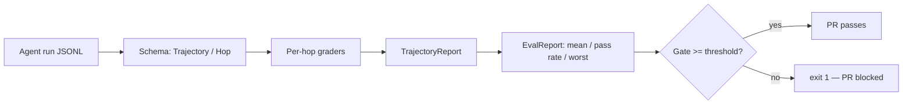

# Architecture

## Components
- **Schema** (`schema.py`): typed `Trajectory`/`Hop` dataclasses, JSONL load/dump, `validate()`.
- **Graders** (`graders.py`): tool choice (exact), argument correctness (fraction of expected key/values), state transition (state_after chains into the next state_before), final answer (exact, else word overlap), final state (key match). Every grader returns 0.0–1.0 with a docstring contract.
- **Generator** (`generate.py`): deterministic golden set — 6 task families x 20 = 120 trajectories in `data/golden.jsonl`, regenerated by `scripts/generate_golden.py`.
- **CLI** (`cli.py`): `eval` prints a JSON report; `gate` exits 1 below `--min-score`; `generate` rewrites the golden set.
- **Config** (`config.py`): environment-based settings (`TRAJ_EVAL_*`), no hardcoded secrets.

## Why per-hop?
Final-answer-only evals hide *where* a run broke. Per-hop grading localises failures to a tool choice, an argument, or a state transition, so a regression points at the hop that caused it.
